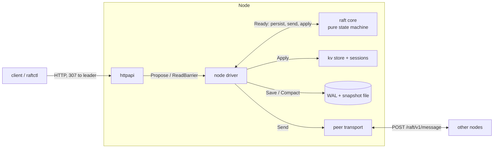

# raftkv

[Português (Brasil)](README.pt-BR.md)

A fault-tolerant key-value store with Raft written from scratch in Go (no Raft library), tested against a deterministic fault-injecting network and a linearizability checker.

[](https://github.com/FrancisWorld/raftkv/actions/workflows/ci.yml)
[](LICENSE)

## Why it exists

Raft is easy to read and hard to get right. The bugs live in the interleavings: a stale leader serving a read, a retried write applied twice, a snapshot that forgets client sessions, a torn WAL tail. So this project is built around being able to *prove* behaviour under faults rather than hoping:

- The consensus core is a **pure, single-threaded state machine** (no goroutines, clocks or sockets). It consumes ticks and messages and emits a `Ready` batch (persist / send / apply), the same shape as etcd's design.
- That makes the whole cluster runnable in **one goroutine on a virtual clock** with a seeded PRNG: partitions, drops, duplication, reordering, delay, crashes and restarts are reproducible. A failing seed replays exactly.
- Every chaos run records a client history and feeds it to a **Wing & Gong linearizability checker** written for this repo.

What is implemented: randomized election timeouts with **pre-vote** and **check-quorum**; log replication with **fast conflict backtracking** (term-level, one round trip); persisted term/vote and a **CRC-protected, fsynced WAL**; **snapshots, log compaction and InstallSnapshot**; **linearizable reads via ReadIndex**; **client sessions with exactly-once dedupe**; an HTTP API with leader redirects; Prometheus metrics; the `raftkv` server and `raftctl` CLI.

## Architecture



| Package | Role |
|---|---|
| `internal/raft` | Election, replication, ReadIndex, snapshots. No I/O. |
| `internal/wal` | `raft.Storage` on disk: append-only WAL, atomic snapshot file. |
| `internal/node` | Runs `Ready` batches in the right order; futures; compaction trigger. |
| `internal/kv` | State machine: map + per-client session table. |
| `internal/httpapi`, `client` | HTTP server, peer transport, Go client. |
| `internal/sim` | Deterministic network, cluster harness, history-recording workload. |
| `internal/lincheck` | Linearizability checker. |

## Quickstart

Requires Go (see `go.mod`). Everything below was run for this README.

```sh
go build -o bin/ ./cmd/...

./bin/raftctl keygen > cluster.key       # a shared key authenticates peer traffic (see Security)
P="1=http://127.0.0.1:18081,2=http://127.0.0.1:18082,3=http://127.0.0.1:18083"
for i in 1 2 3; do ./bin/raftkv --id $i --listen 127.0.0.1:1808$i --peers $P --cluster-key-file cluster.key --data-dir ./data & done
# or simply: ./scripts/dev-cluster.sh   (throwaway key, cleans up on Ctrl-C)

export EP=http://127.0.0.1:18081,http://127.0.0.1:18082,http://127.0.0.1:18083
./bin/raftctl --endpoints $EP status
./bin/raftctl --endpoints $EP put hello world
./bin/raftctl --endpoints $EP get hello
./bin/raftctl --endpoints $EP cas hello wrong x      # exit code 1
```

Sample output (3 local processes):

```text
ENDPOINT                   ROLE       TERM  LEADER  COMMIT  APPLIED  SNAPSHOT  KEYS
http://127.0.0.1:18081     follower      1       2       1        1         0     0
http://127.0.0.1:18082     leader        1       2       1        1         0     0
http://127.0.0.1:18083     follower      1       2       1        1         0     0
$ raftctl put hello world
OK
$ raftctl get hello
world
$ raftctl cas hello wrong x
not applied (current value: "world")
```

I also stopped the leader (SIGTERM), wrote 120 more keys through the survivors, restarted it, and it came back as a follower and installed a snapshot from the new leader (`installed snapshot index=100` in its log) and served the latest key.

With Docker: `scripts/compose-up.sh` (generates a throwaway cluster key per run, then `docker compose up --build -d`) starts three non-root containers on ports 8081-8083 (I ran the same file on other host ports: healthchecks went green, leader redirects worked from the host, and the cluster survived stopping and restarting the leader container). `--client-urls` tells nodes which URLs to give clients when redirecting.

### HTTP API

| Request | Meaning |
|---|---|
| `GET /v1/kv/{key}` | Linearizable read (ReadIndex). 404 if missing. |
| `PUT /v1/kv/{key}` body `{"value":"..."}` | Write. |
| `DELETE /v1/kv/{key}` | Delete. |
| `POST /v1/cas/{key}` body `{"expected":"a","value":"b"}` or `{"expect_absent":true,"value":"b"}` | Compare-and-swap. |
| `GET /v1/status`, `/healthz`, `/readyz`, `/metrics` | Operations. |

Writes accept `Raftkv-Client-Id` and `Raftkv-Seq` headers. A retry that reuses both is executed at most once and gets the original result back (`"duplicate":true`). Followers answer `307` with the leader's URL; the Go client and `raftctl` follow it and retry transient `503`/`504` with the same sequence number.

## Security

- **Peer traffic is authenticated.** Every Raft message POSTed to `/raft/v1/message` carries an HMAC-SHA256 over sender, receiver, term, type, a hash of the body, a timestamp and a random nonce, keyed by a shared cluster key (`--cluster-key-file` or `RAFTKV_CLUSTER_KEY`, at least 32 characters; `raftctl keygen` makes one). The receiver verifies in constant time, accepts timestamps within +/-30 s, and keeps a bounded replay cache (it fails closed when full). Without this, anyone who could reach the port could forge acknowledgements and make a leader commit entries no follower stored.
- **A node refuses to start without a key** unless `--insecure-peer` is given, which logs a loud warning and is for local development only. No key is committed anywhere: `scripts/compose-up.sh` and `scripts/dev-cluster.sh` generate a throwaway one per run.
- Tests: forged sender/term/type/target, tampered body, wrong key, missing headers, replay, stale and future timestamps, cache bounds (`internal/peerauth`), and an end-to-end test where two followers are dead and a forged ack is posted to the real leader: it commits nothing with authentication on, and does commit in `--insecure-peer` mode as a control (`TestForgedAcksCommitNothingWhenPeerAuthIsOn`, `TestForgedAcksCommitWithoutPeerAuth`).
- The client API (`/v1/*`) is still unauthenticated and unencrypted.

## What is hard, and how it is handled

- **Stale reads.** A leader serves a read only after (1) it has committed an entry of its own term, (2) a quorum acknowledged a heartbeat sent *after* the read arrived, and (3) its state machine reached the recorded commit index. A deposed leader's pending reads fail instead of returning old data (`TestMinorityLeaderCannotCommitOrServeReads`).
- **Committing old-term entries.** Only entries from the current term are committed by counting replicas; a new leader appends a no-op immediately (Raft section 5.4.2).
- **Disruptive rejoins.** Pre-vote means an isolated node never inflates its term; check-quorum plus a leader lease makes healthy followers ignore it anyway (`TestPreVoteStopsPartitionedNodeFromInflatingTerm`).
- **Slow log repair.** Rejects carry the conflicting term and its first index, so a follower with a long divergent suffix is repaired in one extra round trip (`TestFastConflictBacktracking`).
- **Exactly-once.** The session table lives in the replicated state machine *and in snapshots*; losing it in a snapshot would silently re-enable double execution (`TestFollowerCatchesUpViaSnapshot` retries after a snapshot restore).
- **Crash safety.** Hard state and entries are fsynced before any message that depends on them is sent. A torn final WAL record is truncated on open; corruption followed by more data fails loudly with `ErrCorrupt`. Snapshot replacement is temp-file + fsync + rename + directory fsync, and a crash between writing the snapshot and rewriting the log is reconciled on open.

## Design decisions and trade-offs

- **Ready-style core** over a goroutine-per-node design: it costs an extra driver layer, but buys deterministic simulation, which found and prevented more bugs than any amount of sleep-based integration testing could.
- **Whole log in memory.** The WAL is the durability mechanism, not a paged log. Simple and fast; memory is bounded only by snapshot frequency.
- **JSON everywhere** (commands, snapshots, peer messages). Debuggable, slower and larger than a binary format.
- **Reads only on the leader** (followers redirect) instead of follower reads; one fewer thing to get wrong.
- **Compaction keeps no trailing entries**, so a follower that is only slightly behind a fresh snapshot is sent the snapshot. This is deliberate for simplicity and gets exercised constantly by the tests.
- **Hand-rolled Prometheus exposition** (`internal/metrics`), about 150 lines, instead of a dependency.

## Testing

```sh
go test -race ./...                        # everything
go test -short ./...                       # fewer chaos seeds, skips the disk chaos run
go test ./internal/wal -run '^$' -fuzz FuzzDecode -fuzztime 30s
golangci-lint run ./...
```

- **Unit** (`internal/raft`): election, pre-vote, check-quorum, backtracking, ReadIndex quorum and not-ready, snapshot install, restart.
- **WAL**: every possible torn-tail truncation point recovers to a prefix; mid-file corruption is rejected; crash windows between snapshot and log rewrite; fuzzing for the record and snapshot decoders (never panic, accepted input re-encodes identically).
- **Simulation** (`internal/sim`): scenarios (failover, minority partition, lost reply plus retry, snapshot catch-up, duplicated and reordered messages, full-cluster restart) and a **seeded chaos test**: 24 seeds alternating 3 and 5 nodes, random partitions, leader isolation, crashes, 0-24% loss and 0-19% duplication, six concurrent clients over three keys. Each run then heals, requires every client to finish and all replicas to converge, and asserts: one leader per term, the same command at each log index on every node, and a **linearizable history**. One more run does the same with real on-disk WALs.
- **Deterministic replay**: running the same seed twice produces an identical final state, operation count and network statistics.
- **The checker is checked**: it rejects stale reads, lost updates, double-successful CAS and non-monotonic reads, accepts generated linearizable histories, and treats unfinished writes as "may or may not have happened".
- **Does the harness have teeth?** I temporarily disabled session dedupe and the chaos test failed with a non-linearizable history on all four seeds of a `-short` run; making `ReadBarrier` a no-op on the leader is caught by the minority-leader test (not by the chaos run, because check-quorum closes the stale-leader window within about one election timeout).
- **Integration** (`internal/httpapi`): three real nodes over loopback HTTP, redirect behaviour, wire-level exactly-once, input validation, leader failure, metrics.

A typical chaos seed completes roughly 3,000 client operations (measured on an Apple Silicon laptop, 8 GB RAM, while other jobs were running); the full `-race` suite takes about a minute there, dominated by the disk-WAL chaos run.

## Limitations

- **Static membership**: the peer set is fixed at startup; no joint consensus or learners.
- **No leadership transfer**, no client-session expiry (the session table grows with the number of distinct clients), no TLS anywhere and no authentication on the client API. Peer authentication uses one shared key, so a compromised node (or anyone holding the key) can impersonate any peer; per-node keys or mTLS would fix that.
- InstallSnapshot sends the snapshot in **one message** (no chunking); large states mean large requests.
- Values are UTF-8 strings in JSON; the store is an in-memory map, so the data set must fit in RAM.
- Linearizability is checked on simulated histories; I have not run Jepsen-style tests against real processes and make no performance claims.

## License

[MIT](LICENSE)

Built by [Chico Oliveira](https://github.com/FrancisWorld)
