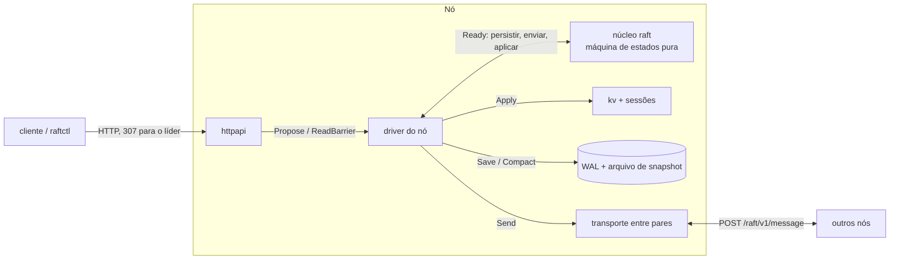

# raftkv

[English](README.md)

Um banco chave-valor tolerante a falhas, com Raft implementado do zero em Go (sem biblioteca de Raft), testado com uma rede determinística que injeta falhas e um verificador de linearizabilidade.

[](https://github.com/FrancisWorld/raftkv/actions/workflows/ci.yml)
[](LICENSE)

## Por que existe

Raft é fácil de ler e difícil de acertar. Os bugs moram nos entrelaçamentos: um líder obsoleto servindo leitura, uma escrita repetida aplicada duas vezes, um snapshot que esquece as sessões de clientes, uma cauda de WAL truncada. Por isso o projeto foi construído para *provar* o comportamento sob falhas:

- O núcleo de consenso é uma **máquina de estados pura e single-thread** (sem goroutines, relógios ou sockets). Ele consome ticks e mensagens e devolve um lote `Ready` (persistir / enviar / aplicar), no mesmo formato do design do etcd.
- Isso permite rodar o cluster inteiro em **uma goroutine com relógio virtual** e PRNG com semente: partições, perdas, duplicação, reordenação, atraso, quedas e reinícios são reprodutíveis. Uma semente que falha reproduz exatamente.
- Cada execução de caos grava um histórico de clientes e o entrega a um **verificador de linearizabilidade Wing & Gong** escrito neste repositório.

Implementado: timeouts de eleição aleatórios com **pre-vote** e **check-quorum**; replicação de log com **retrocesso rápido de conflitos** (por termo, uma ida e volta); term/voto persistidos e **WAL com CRC e fsync**; **snapshots, compactação de log e InstallSnapshot**; **leituras linearizáveis via ReadIndex**; **sessões de cliente com deduplicação exactly-once**; API HTTP com redirecionamento ao líder; métricas Prometheus; servidor `raftkv` e CLI `raftctl`.

## Arquitetura



| Pacote | Papel |
|---|---|
| `internal/raft` | Eleição, replicação, ReadIndex, snapshots. Sem E/S. |
| `internal/wal` | `raft.Storage` em disco: WAL append-only, snapshot atômico. |
| `internal/node` | Executa os lotes `Ready` na ordem certa; futures; gatilho de compactação. |
| `internal/kv` | Máquina de estados: mapa + tabela de sessões por cliente. |
| `internal/httpapi`, `client` | Servidor HTTP, transporte entre pares, cliente Go. |
| `internal/sim` | Rede determinística, harness de cluster, carga que grava histórico. |
| `internal/lincheck` | Verificador de linearizabilidade. |

## Início rápido

Requer Go (veja `go.mod`). Tudo abaixo foi executado para este README.

```sh
go build -o bin/ ./cmd/...

./bin/raftctl keygen > cluster.key       # uma chave compartilhada autentica o tráfego entre nós (veja Segurança)
P="1=http://127.0.0.1:18081,2=http://127.0.0.1:18082,3=http://127.0.0.1:18083"
for i in 1 2 3; do ./bin/raftkv --id $i --listen 127.0.0.1:1808$i --peers $P --cluster-key-file cluster.key --data-dir ./data & done
# ou simplesmente: ./scripts/dev-cluster.sh   (chave descartável, limpa ao dar Ctrl-C)

export EP=http://127.0.0.1:18081,http://127.0.0.1:18082,http://127.0.0.1:18083
./bin/raftctl --endpoints $EP status
./bin/raftctl --endpoints $EP put hello world
./bin/raftctl --endpoints $EP get hello
./bin/raftctl --endpoints $EP cas hello wrong x      # código de saída 1
```

Saída real (3 processos locais):

```text
ENDPOINT                   ROLE       TERM  LEADER  COMMIT  APPLIED  SNAPSHOT  KEYS
http://127.0.0.1:18081     follower      1       2       1        1         0     0
http://127.0.0.1:18082     leader        1       2       1        1         0     0
http://127.0.0.1:18083     follower      1       2       1        1         0     0
$ raftctl put hello world
OK
$ raftctl get hello
world
$ raftctl cas hello wrong x
not applied (current value: "world")
```

Também parei o líder (SIGTERM), gravei mais 120 chaves pelos sobreviventes e reiniciei o nó: ele voltou como seguidor, instalou um snapshot do novo líder (`installed snapshot index=100` no log) e serviu a última chave.

Com Docker: `scripts/compose-up.sh` (gera uma chave de cluster descartável a cada execução e roda `docker compose up --build -d`) sobe três contêineres non-root nas portas 8081-8083 (rodei o mesmo arquivo em outras portas do host: healthchecks saudáveis, redirecionamentos ao líder funcionando a partir do host e o cluster sobreviveu a parar e reiniciar o contêiner do líder). `--client-urls` define as URLs que os nós entregam aos clientes ao redirecionar.

### API HTTP

| Requisição | Significado |
|---|---|
| `GET /v1/kv/{key}` | Leitura linearizável (ReadIndex). 404 se não existir. |
| `PUT /v1/kv/{key}` corpo `{"value":"..."}` | Escrita. |
| `DELETE /v1/kv/{key}` | Remoção. |
| `POST /v1/cas/{key}` corpo `{"expected":"a","value":"b"}` ou `{"expect_absent":true,"value":"b"}` | Compare-and-swap. |
| `GET /v1/status`, `/healthz`, `/readyz`, `/metrics` | Operação. |

Escritas aceitam os cabeçalhos `Raftkv-Client-Id` e `Raftkv-Seq`. Uma repetição com os mesmos valores executa no máximo uma vez e devolve o resultado original (`"duplicate":true`). Seguidores respondem `307` com a URL do líder; o cliente Go e o `raftctl` seguem o redirecionamento e repetem `503`/`504` transitórios com o mesmo número de sequência.

## Segurança

- **O tráfego entre nós é autenticado.** Toda mensagem Raft enviada a `/raft/v1/message` leva um HMAC-SHA256 sobre remetente, destinatário, termo, tipo, hash do corpo, timestamp e nonce aleatório, com uma chave de cluster compartilhada (`--cluster-key-file` ou `RAFTKV_CLUSTER_KEY`, mínimo de 32 caracteres; `raftctl keygen` gera uma). O receptor verifica em tempo constante, aceita timestamps em +/-30 s e mantém um cache de replay limitado (falha fechada quando cheio). Sem isso, qualquer um com acesso à porta poderia forjar confirmações e fazer o líder commitar entradas que nenhum seguidor gravou.
- **Um nó se recusa a iniciar sem chave**, a menos que `--insecure-peer` seja informado, o que gera um aviso em destaque e serve só para desenvolvimento local. Nenhuma chave é versionada: `scripts/compose-up.sh` e `scripts/dev-cluster.sh` geram uma descartável a cada execução.
- Testes: remetente/termo/tipo/destino forjados, corpo adulterado, chave errada, cabeçalhos ausentes, replay, timestamps antigos e futuros, limites do cache (`internal/peerauth`) e um teste de ponta a ponta em que dois seguidores estão mortos e uma confirmação forjada é enviada ao líder real: nada é commitado com autenticação ligada, e é commitado em modo `--insecure-peer` como controle (`TestForgedAcksCommitNothingWhenPeerAuthIsOn`, `TestForgedAcksCommitWithoutPeerAuth`).
- A API de clientes (`/v1/*`) continua sem autenticação e sem criptografia.

## O que é difícil e como foi tratado

- **Leituras obsoletas.** O líder só serve uma leitura depois de (1) ter commitado uma entrada do próprio termo, (2) um quórum confirmar um heartbeat enviado *depois* da chegada da leitura e (3) a máquina de estados alcançar o índice registrado. Leituras pendentes de um líder deposto falham em vez de devolver dado antigo (`TestMinorityLeaderCannotCommitOrServeReads`).
- **Commit de entradas de termos antigos.** Só entradas do termo atual são commitadas por contagem de réplicas; um novo líder anexa um no-op imediatamente (Raft, seção 5.4.2).
- **Retornos disruptivos.** Com pre-vote, um nó isolado nunca infla o termo; check-quorum com lease do líder faz seguidores saudáveis ignorá-lo mesmo assim (`TestPreVoteStopsPartitionedNodeFromInflatingTerm`).
- **Reparo lento de log.** A rejeição leva o termo conflitante e seu primeiro índice; um seguidor com sufixo divergente longo é reparado com uma ida e volta extra (`TestFastConflictBacktracking`).
- **Exactly-once.** A tabela de sessões vive na máquina de estados replicada *e nos snapshots*; perdê-la num snapshot reabilitaria silenciosamente a execução dupla (`TestFollowerCatchesUpViaSnapshot` repete uma escrita após restaurar um snapshot).
- **Segurança em quedas.** Estado e entradas são persistidos com fsync antes de qualquer mensagem que dependa deles. Um último registro de WAL truncado é cortado ao abrir; corrupção seguida de mais dados falha explicitamente com `ErrCorrupt`. A troca de snapshot usa arquivo temporário + fsync + rename + fsync do diretório, e uma queda entre gravar o snapshot e reescrever o log é reconciliada ao abrir.

## Decisões de projeto e trade-offs

- **Núcleo no estilo Ready** em vez de goroutine por nó: custa uma camada de driver, mas dá simulação determinística, que previne mais bugs do que testes de integração baseados em sleep.
- **Log inteiro em memória.** O WAL é o mecanismo de durabilidade, não um log paginado. Simples e rápido; a memória só é limitada pela frequência de snapshots.
- **JSON em todo lugar** (comandos, snapshots, mensagens). Fácil de depurar; mais lento e maior que um formato binário.
- **Leituras só no líder** (seguidores redirecionam), em vez de leitura em seguidores.
- **A compactação não mantém entradas finais**, então um seguidor pouco atrasado recebe o snapshot. É deliberado, por simplicidade, e é exercitado o tempo todo pelos testes.
- **Exposição Prometheus própria** (`internal/metrics`), cerca de 150 linhas, em vez de uma dependência.

## Testes

```sh
go test -race ./...                        # tudo
go test -short ./...                       # menos sementes de caos, pula o caos com disco
go test ./internal/wal -run '^$' -fuzz FuzzDecode -fuzztime 30s
golangci-lint run ./...
```

- **Unitários** (`internal/raft`): eleição, pre-vote, check-quorum, retrocesso, quórum do ReadIndex e not-ready, instalação de snapshot, reinício.
- **WAL**: todo ponto possível de truncamento recupera um prefixo; corrupção no meio é rejeitada; janelas de queda entre snapshot e reescrita do log; fuzzing dos decodificadores (nunca entram em pânico, entrada aceita re-codifica idêntica).
- **Simulação** (`internal/sim`): cenários (failover, partição minoritária, resposta perdida com repetição, catch-up por snapshot, mensagens duplicadas e reordenadas, reinício total) e um **teste de caos com semente**: 24 sementes alternando 3 e 5 nós, partições aleatórias, isolamento do líder, quedas, 0-24% de perda e 0-19% de duplicação, seis clientes concorrentes em três chaves. Cada execução cura a rede, exige que todo cliente termine e todas as réplicas convirjam, e verifica: um líder por termo, o mesmo comando em cada índice em todos os nós e **histórico linearizável**. Outra execução faz o mesmo com WALs reais em disco.
- **Replay determinístico**: a mesma semente duas vezes gera estado final, contagem de operações e estatísticas de rede idênticos.
- **O verificador também é testado**: rejeita leitura obsoleta, atualização perdida, CAS duplo bem-sucedido e leituras não monotônicas, aceita históricos linearizáveis gerados e trata escritas inconclusas como "pode ou não ter acontecido".
- **O harness tem dentes?** Desativei temporariamente a deduplicação de sessões e o teste de caos falhou com histórico não linearizável nas quatro sementes de uma execução `-short`; tornar `ReadBarrier` um no-op no líder é detectado pelo teste do líder minoritário (não pelo caos, porque o check-quorum fecha a janela do líder obsoleto em cerca de um timeout de eleição).
- **Integração** (`internal/httpapi`): três nós reais via HTTP em loopback, redirecionamento, exactly-once no nível do protocolo, validação de entrada, falha do líder, métricas.

Uma semente típica de caos completa cerca de 3.000 operações de cliente (medido num laptop Apple Silicon, 8 GB de RAM, com outros processos rodando); a suíte `-race` completa leva cerca de um minuto, dominada pela execução de caos com WAL em disco.

## Limitações

- **Membros estáticos**: o conjunto de pares é fixo na partida; sem joint consensus nem learners.
- **Sem transferência de liderança**, sem expiração de sessões (a tabela cresce com o número de clientes distintos), sem TLS em lugar nenhum e sem autenticação na API de clientes. A autenticação entre nós usa uma única chave compartilhada, então um nó comprometido (ou quem tiver a chave) pode se passar por qualquer par; chaves por nó ou mTLS resolveriam isso.
- O InstallSnapshot envia o snapshot **em uma única mensagem** (sem fragmentação).
- Valores são strings UTF-8 em JSON; o dado precisa caber em RAM.
- A linearizabilidade é verificada em históricos simulados; não rodei testes estilo Jepsen em processos reais e não faço afirmações de desempenho.

## Licença

[MIT](LICENSE)

Built by [Chico Oliveira](https://github.com/FrancisWorld)
